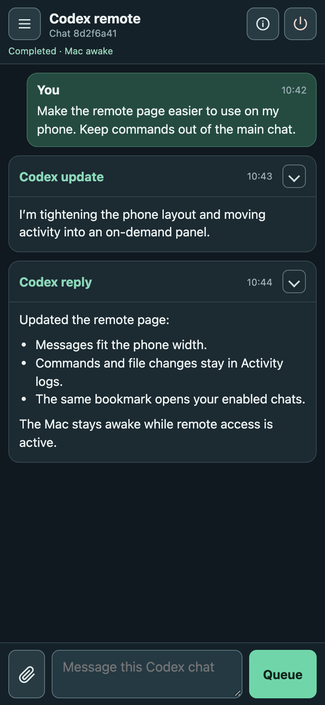
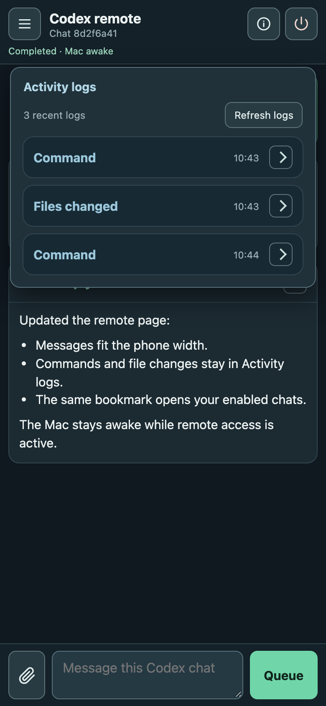

# Codex remote

A small, dependency-free phone bridge for Codex chats already running on your Mac. It mirrors visible chat progress, queues follow-up prompts to the exact thread, and keeps the Mac awake while remote access is enabled. Codex continues to use your own local API-key login. The bridge never asks for or stores an API key.

## Why this exists

OpenAI [documents a native mobile Remote experience](https://help.openai.com/en/articles/20001275-chatgpt-work-and-codex) for **supported** desktop chats. In the API-key-based installation that motivated this project, that feature was unavailable. Starting a new cloud task would not continue the local chat already open on the Mac. The practical need was simple: leave Codex working in its existing chat, then read its replies and send the next prompt from a phone.

Codex remote runs beside the local installation. Your phone connects through private Tailscale Serve to a small Mac service, which reads visible progress and queues prompts to the selected chat. Each person runs their own bridge with their own Codex login; no API key is copied into the phone page or this repository. Availability of OpenAI's native Remote feature can change, so this is a solution for setups where that feature is absent or does not cover the desired local chat.

> **Status:** working pilot for Codex Desktop and CLI queueing. Active-turn steering and approval prompts are not supported yet.

## Preview

These screenshots are rendered from the actual phone page styles with **synthetic messages**. They contain no real chat, network, or account data. Rebuild them with `node docs/render-screenshots.mjs` on a Mac with Chrome installed.

| Chat | Activity popover |
|---|---|
|  |  |

## Requirements

- macOS, Node.js 22 or newer, and a working Codex Desktop or CLI installation.
- Your normal Codex login already configured on the Mac, including API-key based installations.
- Tailscale on the Mac and phone, signed into the same tailnet. Keep the Mac powered, online, and open; `caffeinate -i` cannot override closed-lid sleep.

No npm packages, database server, or second Codex worker are installed.

## Install on the Mac

```sh
git clone https://github.com/Karanjot-singh/codex-remote.git ~/Developer/codex-remote
cd ~/Developer/codex-remote
sh install-macos.sh
curl http://127.0.0.1:8765/health
```

The installer creates a per-user LaunchAgent. The service listens only on `127.0.0.1:8765`. Its state lives outside the repo in `~/.local/state/codex-remote/`, with restricted permissions.

## Set up private phone access

1. On the Mac, run `tailscale serve status --json` and choose an unused HTTPS port. Port `8443` is an example.
2. Map private Tailscale Serve to the local bridge:

   ```sh
   tailscale serve --bg --https=8443 http://127.0.0.1:8765
   ```

3. Install and connect the Tailscale app on the phone. Sign into the tailnet that can reach the Mac.
4. Open the **Phone URL** printed by `control.mjs enable` or the `$remote-control` skill. Bookmark it in Safari.

The Phone URL ends in `/remote` and stays the same for this Mac across chats and re-enables. It opens the latest enabled chat; the hamburger menu shows the others. A per-chat `/remote/<thread-id>` URL is also available. Both require the Mac owner's `Tailscale-User-Login` identity provided by private Serve. If your phone cannot use that identity route, the command also prints a rotating **Fallback URL**. Keep fallback links private.

Do **not** use Tailscale Funnel or a public reverse proxy for this pilot. Tailscale Serve applies your tailnet's access rules and supplies identity headers; Funnel does not. The local Mac is a trusted boundary because another process on the same Mac can reach the loopback listener.

## Enable a chat

Inside the Codex chat you want to control, ask Codex to run:

```sh
node ~/Developer/codex-remote/control.mjs enable
```

The command uses that chat's `CODEX_THREAD_ID`. Repeating it while the chat is enabled reuses its existing token. It prints the stable Phone URL and a fallback link. To use the included skill, link it into Codex's skill directory and start a fresh Codex chat:

```sh
mkdir -p ~/.codex/skills
ln -s ~/Developer/codex-remote/skills/remote-control ~/.codex/skills/remote-control
```

Then type `$remote-control` with “enable this chat,” or select it from `/skills`. The skill prints the full Phone URL in the chat reply.

On the phone, the composer queues text and optionally one image for that thread. The image is resized to JPEG and stored as a private local file for Codex to inspect; it is not a native model attachment. Chat messages stream over SSE, with 30-second polling fallback. The info icon opens command and file-change logs on demand.

## Stop or inspect access

```sh
node ~/Developer/codex-remote/control.mjs status
node ~/Developer/codex-remote/control.mjs link <thread-id>
node ~/Developer/codex-remote/control.mjs disable <thread-id>
node ~/Developer/codex-remote/control.mjs disable
```

The phone's End button disables only its current chat after confirmation. Disabling the last remote chat releases `caffeinate`, so the Mac can idle-sleep normally. Disabling does not close the original Codex chat. The stable `/remote` bookmark returns an error while no chats are enabled, then works again after the next enable. Fallback links expire after 24 hours and rotate when re-enabled after disable or expiry.

## Limits and resource use

- Queueing to the exact Desktop chat has been verified. A true “Send now” action during an active turn needs access to that chat's owning app-server; this Desktop installation uses a private connection, so the bridge does not start a competing writer.
- The page does not forward approval prompts or reasoning content.
- Up to eight chats and eight live viewers are supported. Recent chat events are kept in a bounded memory cache; logs are read from Codex's rollout only when requested.
- Each uploaded image is capped at 3 MiB, total upload storage at 50 MiB. Images older than seven days are removed on later uploads.
- The bridge has measured roughly 43–50 MiB RSS while enabled on one Mac, excluding Codex and the existing Tailscale daemon. Resource use will vary by machine.

Run `npm test` for parser and HTTP tests. `curl http://127.0.0.1:8765/health` checks the local service; `pmset -g assertions` shows the wake assertion while a chat is enabled.

## Publishing and personal configuration

This repository contains code and synthetic illustrations. Runtime tokens, cookies, uploaded images, logs, `.env` files, local state, and certificates are excluded by `.gitignore` and must remain on each user's Mac. Do not paste a live fallback link, API key, or transcript into a GitHub issue. Each person installs the bridge on their own Mac and uses their own Codex login and Tailscale identity.
